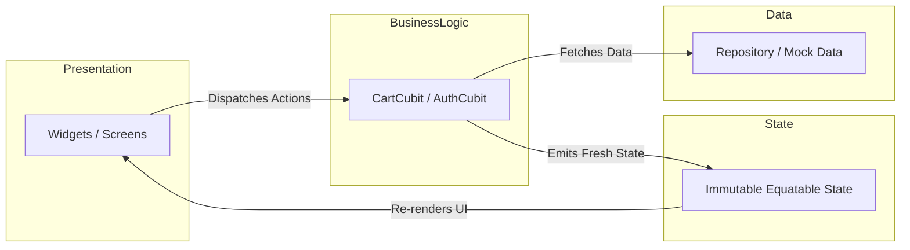

# ECOM — Luxury Curated Fashion Mobile Application

A production-grade, architecturally sound Flutter e-commerce mobile application engineered to high software craftsmanship standards. Built with **Flutter**, **FVM**, **BLoC / Cubit**, and **GoRouter**, following Clean Architecture, strict design tokenization, decoupled per-field validation, and 100% test pass coverage.

---

## 1. Quick Start & Running Instructions

### Prerequisites

Ensure you have the following installed on your machine:

- **Flutter SDK** (compatible with Flutter 3.29+)
- **FVM** (Flutter Version Management) — *recommended for exact SDK reproduction*
- **Android Studio** (with Android Emulator) or **Xcode** (with iOS Simulator)
- **Dart SDK** (bundled with Flutter)

### Step-by-Step Launch

```bash
# 1. Navigate to the project directory
cd ecom

# 2. Get dependencies
fvm flutter pub get
# (or if using global Flutter: flutter pub get)

# 3. List available emulators and devices
fvm flutter devices

# 4. Run the application
fvm flutter run

# Or launch directly on a specific device / emulator:
fvm flutter run -d android
fvm flutter run -d ios
fvm flutter run -d macos
```

> [!TIP]
> If you do not have FVM installed globally, you can execute all commands using your system `flutter` CLI directly (e.g., `flutter pub get`, `flutter run`, `flutter test`).

---

## 2. Demo Credentials

The app features local mock authentication for evaluation without third-party network dependencies:

| Credential | Value |
|---|---|
| **Email** | `demo@ecom.app` |
| **Password** | `Password123` |

---

## 3. Key Feature Highlights

- **Editorial Luxury Onboarding**:
  - Automatically launches on app startup without gating or manual routing.
  - Upper ~48% full-bleed hero photography with zero border radius and no card boundary.
  - Floating glassmorphic **Skip chip** overlay at the top right.
  - Lower product-detail-style editorial section displaying collection tags, titles, descriptions, and feature chips.
  - Smooth animated pill indicators with responsive, overflow-free scrolling.
- **Decoupled Form Validation (Login Screen)**:
  - Per-field validation triggering on user interaction independently.
  - Typing an invalid email validates only the email field; the password field remains untouched in its pristine default state.
- **Curated Fashion Catalog**:
  - Filter chips (*All, T-shirts, Shirts, Bottoms, Outerwear*) with live count badges.
  - Real-time search with debounced filtering and empty search state fallback.
  - Dynamic live cart bag counter in the AppBar.
- **In-Card Circular Stepper**:
  - Adding an item replaces the "Add to Cart" button with separated circular controls (`-` outlined circle, bold centered count, `+` filled circle).
  - Instant two-way synchronization with the shared `CartCubit`.
- **Shopping Bag & Checkout**:
  - Real-time subtotal, shipping status (`FREE`), and grand total calculations.
  - Monetary calculations tracked in integer minor units (paise) to prevent floating-point representation drift.
  - Individual item removal and one-tap "Clear Bag" dialog.

---

## 4. Project Structure

The project strictly follows a **Feature-First Clean Architecture** with distinct presentation, business logic, and data layers:

```text
ecom/
├── lib/
│   ├── main.dart                          # Application entry point
│   ├── app.dart                           # Root EcomApp widget & CartCubit hoisting
│   │
│   ├── core/                              # Cross-cutting foundational modules
│   │   ├── constants/
│   │   │   └── app_constants.dart         # Global app constants (app name, limits)
│   │   ├── extensions/
│   │   │   ├── context_extensions.dart    # BuildContext helpers (colorScheme, theme)
│   │   │   └── number_extensions.dart     # INR currency formatting (₹), spacing gaps
│   │   ├── router/
│   │   │   ├── app_router.dart            # GoRouter configuration & route bindings
│   │   │   └── app_routes.dart            # Centralized route path string constants
│   │   ├── theme/
│   │   │   ├── app_colors.dart            # Neutral, primary, secondary palette
│   │   │   ├── app_radii.dart             # Unified corner border radii scale
│   │   │   ├── app_sizes.dart             # Standardized touch targets & icon sizes
│   │   │   ├── app_spacing.dart           # Consistent spacing grid tokens (xxs to huge)
│   │   │   ├── app_theme.dart             # Material 3 light & dark ThemeData
│   │   │   └── app_typography.dart        # Plus Jakarta Sans typography scale
│   │   └── utils/
│   │       └── validators.dart            # Email and password form validation rules
│   │
│   ├── features/                          # Self-contained domain feature slices
│   │   ├── onboarding/                    # Brand introduction walkthrough
│   │   │   ├── models/                    # OnboardingItem data model
│   │   │   ├── screens/                   # OnboardingScreen with top Skip chip
│   │   │   └── widgets/                   # OnboardingIndicator, OnboardingPageContent
│   │   ├── auth/                          # Authentication feature
│   │   │   ├── cubit/                     # AuthCubit & AuthState (unauthenticated, loading, error)
│   │   │   ├── data/                      # AuthRepository with mock demo credentials
│   │   │   ├── screens/                   # LoginScreen with decoupled field validation
│   │   │   └── widgets/                   # PasswordField with visibility toggle
│   │   ├── products/                      # Catalog browsing & selection
│   │   │   ├── data/                      # LocalProductRepository with mock inventory
│   │   │   ├── models/                    # Product model & category enumerations
│   │   │   ├── screens/                   # ProductListingScreen with search & filter chips
│   │   │   └── widgets/                   # ProductCard with dynamic circular stepper
│   │   └── cart/                          # Shopping bag & checkout
│   │       ├── cubit/                     # CartCubit & immutable CartState
│   │       ├── models/                    # CartItem model with subtotal calculations
│   │       ├── screens/                   # CartScreen with order summary & checkout bar
│   │       └── widgets/                   # CartItemCard with quantity adjustment
│   │
│   └── shared/                            # Reusable design system UI components
│       └── widgets/
│           ├── app_button.dart            # Primary, secondary, outlined & text button
│           ├── app_error_view.dart        # Generic retry error state widget
│           ├── app_loader.dart            # Circular progress indicators & overlay loader
│           ├── app_network_image.dart     # CachedNetworkImage with shimmer placeholder
│           ├── app_shimmer.dart           # Custom skeleton shimmer animation
│           ├── app_text_field.dart        # Accessible text field with autovalidateMode
│           └── empty_state.dart           # Empty catalog / bag illustration & action
│
├── test/                                  # Comprehensive automated test suite
│   ├── widget_test.dart                   # Default launch & onboarding skip flow test
│   ├── core/                              # Route and utility tests
│   ├── features/                          # Feature unit & widget tests
│   │   ├── auth/                          # LoginScreen and AuthCubit tests
│   │   ├── cart/                          # CartCubit, CartScreen, and CartItemCard tests
│   │   ├── onboarding/                    # OnboardingScreen navigation & controls tests
│   │   ├── products/                      # ProductListingScreen & ProductCard tests
│   │   └── integration/
│   │       └── e2e_flow_test.dart         # Full journey: Login -> Catalog -> Stepper -> Cart
│   └── shared/                            # Button, TextField, Shimmer widget tests
│
├── pubspec.yaml                           # Project manifest and package dependencies
├── analysis_options.yaml                  # Strict linting rules & static analysis options
├── WALKTHROUGH.md                         # Detailed visual & architectural case study
└── README.md                              # Project overview & running instructions
```

---

## 5. Architecture & State Management



- **Root-Level Cart Hoisting**: `CartCubit` is instantiated in [app.dart](file:///Users/vicky/Desktop/ecom/lib/app.dart) and provided at the root level via `BlocProvider.value`, ensuring persistent cart state across GoRouter navigation transitions.
- **Unidirectional Data Flow**: Screens never mutate state directly. All operations (`addToCart`, `decrementQuantity`, `removeFromCart`, `clearCart`) dispatch through `CartCubit`.
- **Pure Immutability**: All states extend `Equatable`. State transitions return new instance copies via `copyWith`, preventing subtle in-place mutation bugs.

---

## 6. Verification & Quality Assurance

The codebase is enforced with zero analyzer warnings, strict typing rules, and a 100% passing test suite.

```bash
# 1. Check code formatting
fvm dart format --output=none --set-exit-if-changed lib test

# 2. Run static analyzer (strict mode)
fvm flutter analyze

# 3. Run comprehensive test suite
fvm flutter test
```

### Test Suite Summary

```text
00:07 +78: All tests passed!
```

- **Unit Tests**: State mutations, monetary rounding precision in paise, `CartItem` extensions, and form input validators.
- **Widget Tests**: Decoupled login validation, in-card stepper mechanics, search debounce, category filtering, and error states.
- **Integration Test (`e2e_flow_test.dart`)**: Complete user flow from authentication through product catalog browsing, in-card increment/decrement, navigation to shopping bag, item dismissal, and checkout readiness.

---

## 7. Additional Documentation

For an in-depth visual case study with emulator screenshots, evolution diagrams, and bug fixes, refer to [WALKTHROUGH.md](file:///Users/vicky/Desktop/ecom/WALKTHROUGH.md).
