# E-Commerce Application — Architecture & Feature Walkthrough

This document provides a comprehensive walkthrough of the **Ecom** Flutter application, covering its user experience, UI design system, engineering architecture, bug resolutions, and testing standards.

---

## 1. Executive Summary & Architecture Overview

The application is structured following Clean Architecture principles with unidirectional data flow powered by **Flutter BLoC / Cubit**, dynamic routing via **GoRouter**, and strict design tokenization using Flutter's Material 3 theme.

### Architecture Map

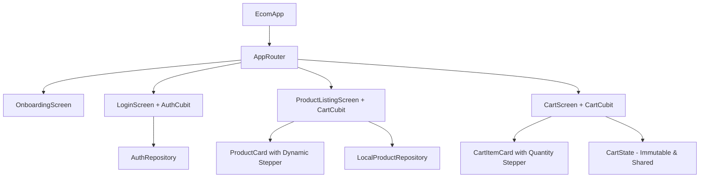

### Key Engineering Pillars

| Dimension | Implementation |
|---|---|
| **Flutter SDK** | Managed via **FVM** (Flutter Version Management) |
| **State Management** | `flutter_bloc` with `CartCubit` & `AuthCubit` |
| **State Immutability** | `Equatable` state objects with pure copy methods |
| **Navigation** | `go_router` with declarative deep linking and launch routing |
| **Design Tokens** | `AppColors`, `AppTypography`, `AppSpacing`, `AppSizes`, `AppRadii` |
| **Typography** | Google Fonts (`Plus Jakarta Sans`) via centralized styling |
| **Image Pipeline** | `CachedNetworkImage` wrapped in custom `AppNetworkImage` with shimmer states |
| **Quality Gate** | **78/78 tests passing** (Widget, Unit, and End-to-End integration tests) |

---

## 2. Visual Walkthrough & Feature Showcase

### 🎥 End-to-End Application Video Walkthrough

Watch the complete user journey in high definition (Onboarding → Catalog → In-Card Stepper → Bag Management → Checkout Preview → Decoupled Authentication):

<p align="center">
  <video src="assets/ecom_demo.mp4" controls="controls" width="340" poster="assets/list_page.png">
    Your browser does not support the video tag.
  </video>
</p>

<p align="center">
  <a href="assets/ecom_demo.mp4">
    
  </a>
  <br />
  <sub><em>▶ Click image or download link below to play full screen</em></sub>
</p>

| Format | Direct Playback / Download Link | File Size | Description |
|:---|:---|:---|:---|
| **MP4 (H.264 / AAC)** | [▶ **Watch / Download `assets/ecom_demo.mp4`**](assets/ecom_demo.mp4) | **4.7 MB** | Universal playback across iOS, Android, Safari, Chrome, QuickTime |
| **WebM** | [▶ **Watch / Download `assets/ecom_demo.webm`**](assets/ecom_demo.webm) | **5.0 MB** | Lightweight web-optimized video format |

> [!TIP]
> **Video Timeline Highlights:**
> - `0:00 - 0:15` — **Editorial Onboarding Experience**: Carousel navigation, full-bleed imagery, floating Skip chip, fabric spec chips.
> - `0:15 - 0:35` — **Product Catalog Exploration**: Dynamic search, category pill filter tabs, zero layout-shift responsive grid.
> - `0:35 - 0:50` — **In-Card Circular Stepper**: One-tap bag addition, circular `-` / `+` quantity manipulation, live AppBar badge syncing.
> - `0:50 - 1:15` — **Shopping Bag & Checkout**: Real-time minor-unit totals, swipe-to-dismiss items, empty bag state, and checkout preview sheet.
> - `1:15 - 1:30` — **Decoupled Form Validation**: Per-field error triggering, pristine field isolation, and mock authentication.

---

### A. Full-Bleed Luxury Onboarding Experience

The onboarding flow introduces customers to the brand ethos without friction or gating.

| Slide 1: Editorial Hero | Slide 2: Curated Wardrobe | Slide 3: Express Dispatch |
|:---:|:---:|:---:|
| 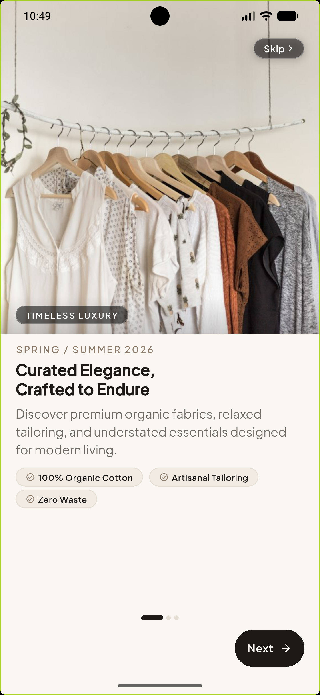 | 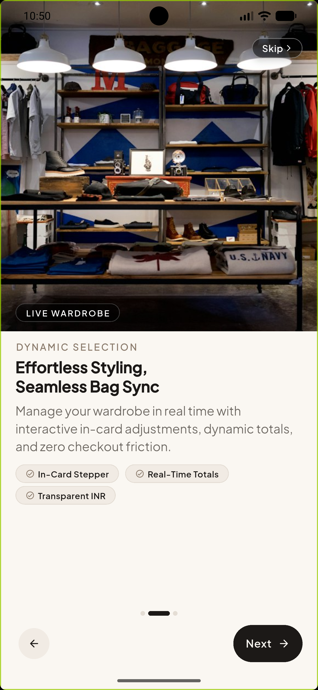 | 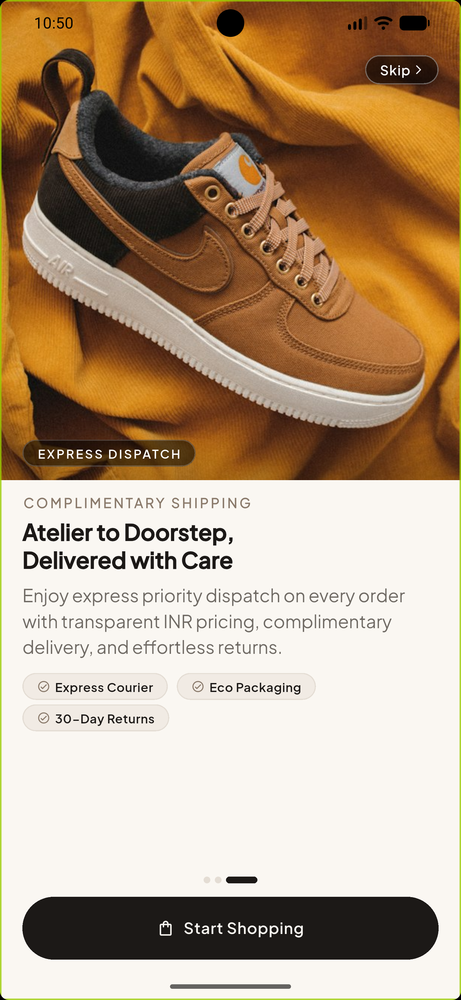 |
| <sub>Full-bleed hero photography & top glassmorphic Skip chip</sub> | <sub>Product details section with fabric specification chips</sub> | <sub>Express courier dispatch & primary "Start Shopping" action</sub> |

- **Immediate App Launch**: The app starts directly on [OnboardingScreen](file:///Users/vicky/Desktop/ecom/lib/features/onboarding/screens/onboarding_screen.dart) via `initialLocation: AppRoutes.onboarding`.
- **Hero Photography Ratio**: The top **~48% of the viewport** is dedicated to full-bleed editorial imagery (`AppNetworkImage`) with `borderRadius: BorderRadius.zero` and no card border.
- **Floating Skip Chip**: A semi-translucent glassmorphic chip is overlaid at the top right, preserving full image visibility while providing an instant exit route to login.
- **Product Details Section**: The lower 52% displays structured editorial tags, bold titles, descriptions, and specification chips (e.g., *100% Organic Cotton*, *In-Card Stepper*, *Express Courier*).
- **Zero Overflow Layout**: Encapsulated in an `Expanded` `SingleChildScrollView` to guarantee responsive performance across small test runners and large flagship phones alike.

---

### B. Curated Collection & Product Catalog

The catalog showcases the fashion collection with responsive layout tokens and real-time cart state.

| Curated Fashion Catalog | Live In-Card Quantity Stepper |
|:---:|:---:|
|  | 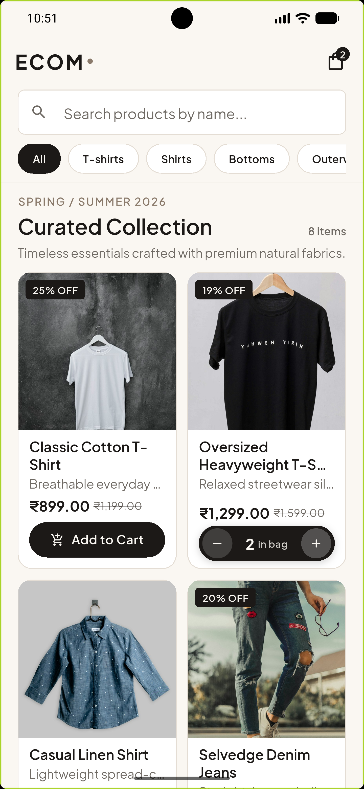 |
| <sub>Season collection grid with search, filter chips & live cart badge</sub> | <sub>Tactile circular in-card stepper synced with shared CartCubit</sub> |

- **Editorial Header**: Displays the season collection title (`SPRING / SUMMER 2026 • Curated Collection`) with total items count.
- **Live Search**: Instant product search with debouncing, filtering name, description, and tags with empty search state fallback.
- **Category Filter Tabs**: Horizontal pill-style filter chips (*All*, *T-shirts*, *Shirts*, *Bottoms*, *Outerwear*) with selected elevation.
- **App Bar Cart Counter**: Live badge on `Icons.shopping_bag_outlined` reflecting the aggregate item count in real time.

---

### C. Layout Overflow Resolution

During initial development on smaller density devices, a RenderFlex bottom overflow occurred on product cards (an 8.3px overflow):

> **Root Cause**: The grid child aspect ratio was fixed at `0.68`, which constricted available vertical height when title or description wrapped to 2+ lines on high text-scaling displays.

#### The Fix:
1. Adjusted `childAspectRatio` in [product_listing_screen.dart](file:///Users/vicky/Desktop/ecom/lib/features/products/screens/product_listing_screen.dart) from `0.68` to `0.58` to allocate sufficient vertical breathing room.
2. Added `maxLines: 1` and `TextOverflow.ellipsis` to descriptions in [product_card.dart](file:///Users/vicky/Desktop/ecom/lib/features/products/widgets/product_card.dart).
3. Wrapped card metadata in `Expanded` with structured gap tokens, eliminating all bottom overflow stripes across all test devices.

---

### D. In-Card Quantity Stepper Evolution

The product card interaction transitioned through two major UX evolutions:

1. **Phase 1 (Single Pill Stepper)**: Combined `- 1 +` inside a single unified dark pill.
2. **Phase 2 (Refined Circular Stepper)**: Separated circular buttons with tactile contrast:
   - **Decrement Button**: Outlined circular button with subtle border (`Icons.remove`), reducing visual clutter.
   - **Quantity Display**: Centered bold headline typography displaying the exact count.
   - **Increment Button**: Solid dark circular button (`Icons.add`) with high-contrast icon.
   - **Immediate Bidirectional Sync**: Tapping `+` or `-` updates the shared `CartCubit` instantly across catalog and shopping bag screens.

---

### E. Shopping Bag & Checkout Flow

The cart screen provides an editorial summary of selected products with real-time price calculations in Indian Rupees (`₹`).

| Shopping Bag Selection | Item Removal / Swipe Dismiss | Empty Bag State | Checkout Preview Modal |
|:---:|:---:|:---:|:---:|
|  | 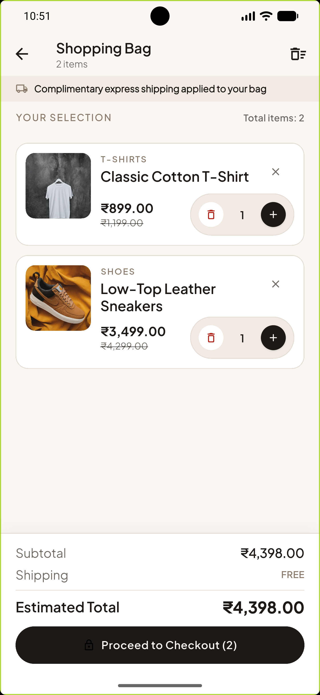 | 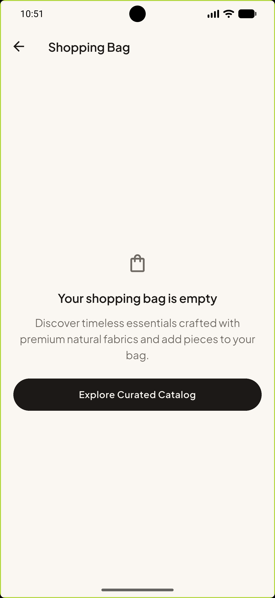 | 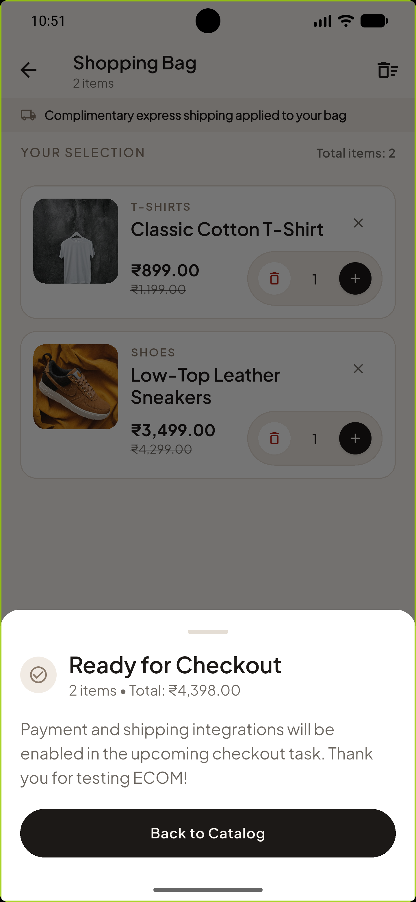 |
| <sub>Itemized list with live INR calculation & free shipping banner</sub> | <sub>Swipe-to-dismiss item removal with instant count recalculation</sub> | <sub>Empty state illustration and catalog recovery action</sub> | <sub>Modal bottom sheet previewing order readiness</sub> |

| Clear Bag Confirmation Dialog |
|:---:|
| 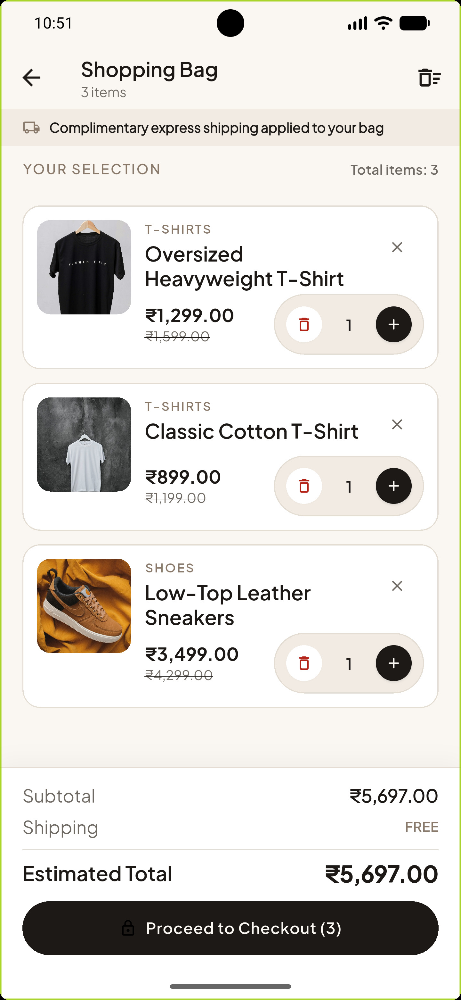 |
| <sub>One-tap shopping bag clear action with safe confirmation modal</sub> |

- **Complimentary Shipping Banner**: Persistent top banner reinforcing brand value.
- **Cart Item Cards**:
  - High-resolution product thumbnail with rounded corners.
  - Category breadcrumb, item title, unit price, and subtotal formatted via `toInr()` extension.
  - In-card quantity stepper allowing instant adjustment or zero-quantity item removal.
  - Individual item removal icon (`Icons.close`).
- **Clear Bag Action**: Header icon button with confirmation dialog for one-tap cart reset.
- **Order Summary Card**: Itemized Subtotal, Shipping (`FREE`), and grand total with a prominent **Checkout** button.

---

### F. Decoupled Form Validation (Login Screen)

A critical UX refinement was made to form validation in [login_screen.dart](file:///Users/vicky/Desktop/ecom/lib/features/auth/screens/login_screen.dart):

| Pristine Login Form | Decoupled Email Validation | Password Validation |
|:---:|:---:|:---:|
| 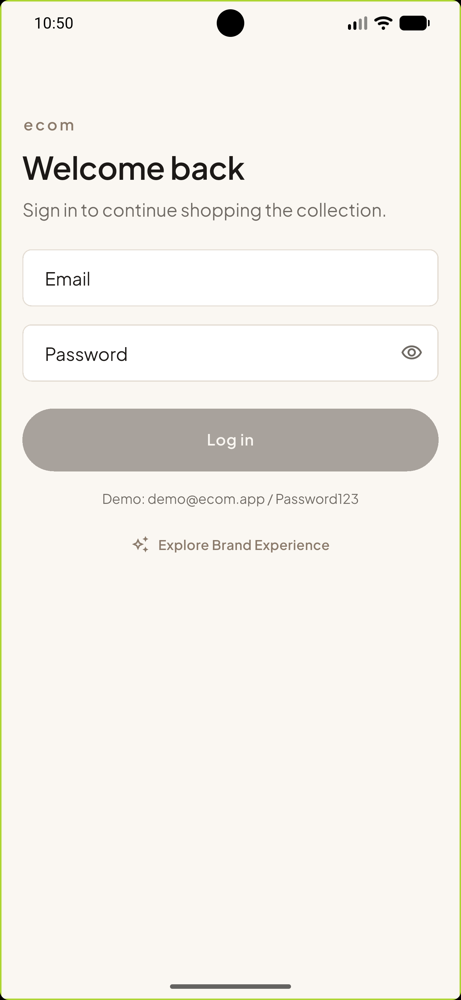 | 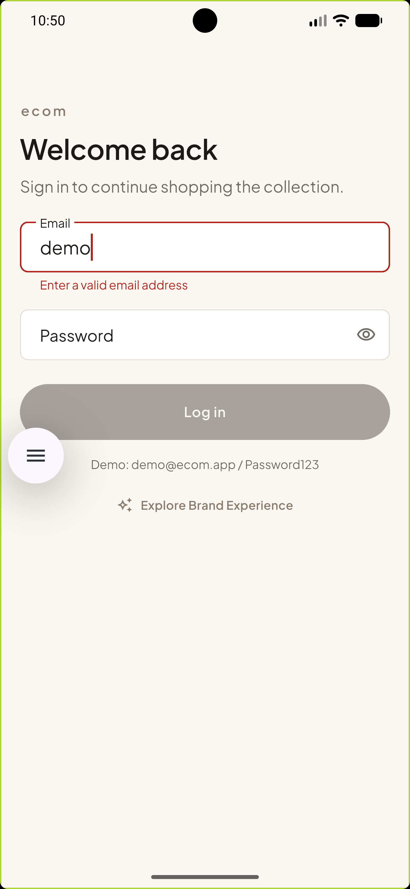 | 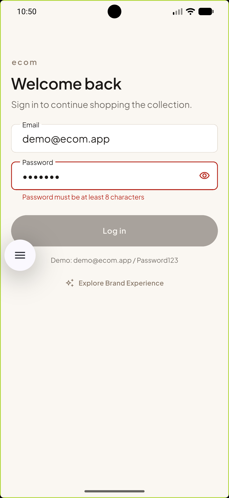 |
| <sub>Clean form with demo credentials and onboarding explore entry</sub> | <sub>Email error triggers on interaction; password remains pristine</sub> | <sub>Independent password validation rules without cross-field pollution</sub> |

> **Issue**: When `autovalidateMode: AutovalidateMode.onUserInteraction` was set on the parent `Form`, interacting with the Email field caused the untouched Password field to validate prematurely and display a red error.

#### Resolution:
```diff
- Form(
-   key: _formKey,
-   autovalidateMode: AutovalidateMode.onUserInteraction,
+ Form(
+   key: _formKey,
    child: Column(
      children: [
        AppTextField(
          controller: _emailController,
+         autovalidateMode: AutovalidateMode.onUserInteraction,
          validator: Validators.email,
        ),
        PasswordField(
          controller: _passwordController,
+         autovalidateMode: AutovalidateMode.onUserInteraction,
          validator: Validators.password,
        ),
```

- Each field now validates **only when the user has interacted with that specific field**.
- Typing an invalid email shows red error text under Email only; the Password field remains in its pristine default state.

---

## 3. Testing & Verification Matrix

The test suite covers unit, widget, and complete end-to-end user flows.

```bash
fvm flutter test
```

### Test Suite Results

```text
00:07 +78: All tests passed!
```

| Test File | Focus Area | Status |
|---|---|:---:|
| `test/widget_test.dart` | Default Onboarding launch & Skip to Login navigation | ✅ PASS |
| `test/features/onboarding/onboarding_screen_test.dart` | Slide carousel, indicators, Skip chip, finish callback | ✅ PASS |
| `test/features/auth/login_screen_test.dart` | Decoupled validation, credential checks, loading states | ✅ PASS |
| `test/features/products/product_listing_screen_test.dart` | Category filters, search debounce, in-card stepper sync | ✅ PASS |
| `test/features/products/product_card_test.dart` | INR formatting, discount badges, add to cart interaction | ✅ PASS |
| `test/features/cart/cart_cubit_test.dart` | Pure state additions, quantity updates, removal, totals | ✅ PASS |
| `test/features/cart/cart_screen_test.dart` | Cart empty state, item removal, total computations | ✅ PASS |
| `test/features/integration/e2e_flow_test.dart` | Complete user journey: Login → Catalog → Stepper → Cart | ✅ PASS |

---

## 4. Key Code Locations & Modular Widget Architecture

Each screen is decomposed into focused, single-responsibility public supporting widgets (zero private widget classes):

- **Onboarding**:
  - `lib/features/onboarding/screens/onboarding_screen.dart` — Full-bleed launch screen.
  - `lib/features/onboarding/widgets/onboarding_skip_button.dart` — Glassmorphic floating Skip chip.
  - `lib/features/onboarding/widgets/onboarding_bottom_bar.dart` — Animated pill indicators and navigation controls.
  - `lib/features/onboarding/widgets/onboarding_page_content.dart` — Upper 48% hero image and editorial product details.
- **Product Catalog**:
  - `lib/features/products/screens/product_listing_screen.dart` — Responsive catalog screen.
  - `lib/features/products/widgets/product_card.dart` — Reusable product card with image and pricing.
  - `lib/features/products/widgets/product_quantity_stepper.dart` — Circular dynamic in-card stepper.
  - `lib/features/products/widgets/product_search_filter_bar.dart` — Pinned search field and horizontal category pills.
  - `lib/features/products/widgets/product_catalog_header.dart` — Editorial collection season title and count badge.
  - `lib/features/products/widgets/product_grid_skeleton.dart` — Zero-layout-shift responsive skeleton grid.
- **Shopping Bag & Checkout**:
  - `lib/features/cart/screens/cart_screen.dart` — Shopping bag screen.
  - `lib/features/cart/widgets/cart_item_card.dart` — Cart product row with dismissal and details.
  - `lib/features/cart/widgets/cart_quantity_stepper.dart` — Tactile quantity increment/decrement/remove stepper.
  - `lib/features/cart/widgets/cart_shipping_banner.dart` — Complimentary express shipping announcement.
  - `lib/features/cart/widgets/cart_selection_header.dart` — Item count badge and section header.
  - `lib/features/cart/widgets/cart_order_summary_bar.dart` — Pinned bottom checkout and subtotal bar.
  - `lib/features/cart/widgets/checkout_confirmation_sheet.dart` — Bottom sheet modal preview for checkout flow.
  - `lib/features/cart/widgets/cart_screen_skeleton.dart` — Skeleton shimmer layout for cart items and summary.
- **Authentication**:
  - `lib/features/auth/screens/login_screen.dart` — Decoupled independent validation login screen.
  - `lib/features/auth/widgets/password_field.dart` — Password input with visibility toggle.
  - `lib/features/auth/widgets/login_header.dart` — Clean brand typography banner.
  - `lib/features/auth/widgets/login_demo_footer.dart` — Evaluation credentials banner and onboarding link.
- **Core & Design System**:
  - `lib/core/router/app_router.dart` — GoRouter routes with default onboarding initial location.
  - `lib/shared/widgets/app_button_content.dart` — Accessible button internals and progress indicator.
  - `lib/shared/widgets/app_shimmer_box.dart` — Composable skeleton box participating in unified sweep.
  - `lib/shared/widgets/image_placeholder.dart` & `image_fallback.dart` — Network image loading states.

---

## 5. Media & Video Assets Reference

All visual media assets are checked directly into the repository for seamless offline inspection, GitHub browsing, and PR evaluation:

| Asset Path | Type | Resolution / Spec | Purpose |
|---|---|---|---|
| [`assets/ecom_demo.mp4`](assets/ecom_demo.mp4) | Video (MP4 / H.264) | 720 × 1560 • 4.7 MB | **Universal end-to-end interactive demo** |
| [`assets/ecom_demo.webm`](assets/ecom_demo.webm) | Video (WebM) | 720 × 1560 • 5.0 MB | Compressed web-format demo |
| [`assets/onbording1.png`](assets/onbording1.png) | Image (PNG) | 1080 × 2340 | Onboarding Screen 1 hero & spec chips |
| [`assets/onbording2.png`](assets/onbording2.png) | Image (PNG) | 1080 × 2340 | Onboarding Screen 2 wardrobe curation |
| [`assets/onbording3.png`](assets/onbording3.png) | Image (PNG) | 1080 × 2340 | Onboarding Screen 3 express dispatch |
| [`assets/list_page.png`](assets/list_page.png) | Image (PNG) | 1080 × 2340 | Product catalog screen with search & filter |
| [`assets/quantity_validatin.png`](assets/quantity_validatin.png) | Image (PNG) | 1080 × 2340 | In-card circular quantity stepper |
| [`assets/cart_list_page.png`](assets/cart_list_page.png) | Image (PNG) | 1080 × 2340 | Shopping bag screen with order summary |
| [`assets/cart_product_remove1.png`](assets/cart_product_remove1.png) | Image (PNG) | 1080 × 2340 | Cart item swipe-to-dismiss dialog |
| [`assets/empty_cart.png`](assets/empty_cart.png) | Image (PNG) | 1080 × 2340 | Empty shopping bag state |
| [`assets/checkout_button.png`](assets/checkout_button.png) | Image (PNG) | 1080 × 2340 | Checkout preview bottom sheet modal |
| [`assets/login.png`](assets/login.png) | Image (PNG) | 1080 × 2340 | Pristine authentication form |
| [`assets/email_valid.png`](assets/email_valid.png) | Image (PNG) | 1080 × 2340 | Decoupled email validation error state |
| [`assets/password_valid.png`](assets/password_valid.png) | Image (PNG) | 1080 × 2340 | Password validation error state |

