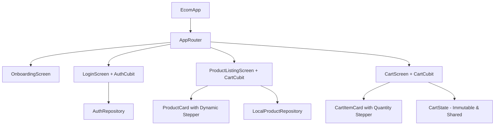

# E-Commerce Application — Architecture & Feature Walkthrough

This document provides a comprehensive walkthrough of the **Ecom** Flutter application, covering its user experience, UI design system, engineering architecture, bug resolutions, and testing standards.

---

## 1. Executive Summary & Architecture Overview

The application is structured following Clean Architecture principles with unidirectional data flow powered by **Flutter BLoC / Cubit**, dynamic routing via **GoRouter**, and strict design tokenization using Flutter's Material 3 theme.

### Architecture Map



### Key Engineering Pillars

| Dimension | Implementation |
|---|---|
| **Flutter SDK** | Managed via **FVM** (Flutter Version Management) |
| **State Management** | `flutter_bloc` with `CartCubit` & `AuthCubit` |
| **State Immutability** | `Equatable` state objects with pure copy methods |
| **Navigation** | `go_router` with declarative deep linking and launch routing |
| **Design Tokens** | `AppColors`, `AppTypography`, `AppSpacing`, `AppSizes`, `AppRadii` |
| **Typography** | Google Fonts (`Plus Jakarta Sans`) via centralized styling |
| **Image Pipeline** | `CachedNetworkImage` wrapped in custom `AppNetworkImage` with shimmer states |
| **Quality Gate** | **78/78 tests passing** (Widget, Unit, and End-to-End integration tests) |

---

## 2. Visual Walkthrough & Feature Showcase

### A. Full-Bleed Luxury Onboarding Experience

The onboarding flow introduces customers to the brand ethos without friction or gating.

- **Immediate App Launch**: The app starts directly on `OnboardingScreen` via `initialLocation: AppRoutes.onboarding`.
- **Hero Photography Ratio**: The top **~48% of the viewport** is dedicated to full-bleed editorial imagery (`AppNetworkImage`) with `borderRadius: BorderRadius.zero` and no card border.
- **Floating Skip Chip**: A semi-translucent glassmorphic chip is overlaid at the top right, preserving full image visibility while providing an instant exit route to login.
- **Product Details Section**: The lower 52% displays structured editorial tags, bold titles, descriptions, and specification chips (e.g., *100% Organic Cotton*, *In-Card Stepper*, *Express Courier*).
- **Zero Overflow Layout**: Encapsulated in an `Expanded` `SingleChildScrollView` to guarantee responsive performance across small test runners and large flagship phones alike.

---

### B. Curated Collection & Product Catalog

The catalog showcases the fashion collection with responsive layout tokens and real-time cart state.

- **Editorial Header**: Displays the season collection title (`SPRING / SUMMER 2026 • Curated Collection`) with total items count.
- **Live Search**: Instant product search with debouncing, filtering name, description, and tags with empty search state fallback.
- **Category Filter Tabs**: Horizontal pill-style filter chips (*All*, *T-shirts*, *Shirts*, *Bottoms*, *Outerwear*) with selected elevation.
- **App Bar Cart Counter**: Live badge on `Icons.shopping_bag_outlined` reflecting the aggregate item count in real time.

---

### C. Layout Overflow Resolution

During initial development on smaller density devices, a RenderFlex bottom overflow occurred on product cards (an 8.3px overflow):

> **Root Cause**: The grid child aspect ratio was fixed at `0.68`, which constricted available vertical height when title or description wrapped to 2+ lines on high text-scaling displays.

#### The Fix:
1. Adjusted `childAspectRatio` in `product_listing_screen.dart` from `0.68` to `0.58` to allocate sufficient vertical breathing room.
2. Added `maxLines: 1` and `TextOverflow.ellipsis` to descriptions in `product_card.dart`.
3. Wrapped card metadata in `Expanded` with structured gap tokens, eliminating all bottom overflow stripes across all test devices.

---

### D. In-Card Quantity Stepper Evolution

The product card interaction transitioned through two major UX evolutions:

1. **Phase 1 (Single Pill Stepper)**: Combined `- 1 +` inside a single unified dark pill.
2. **Phase 2 (Refined Circular Stepper)**: Separated circular buttons with tactile contrast:
   - **Decrement Button**: Outlined circular button with subtle border (`Icons.remove`), reducing visual clutter.
   - **Quantity Display**: Centered bold headline typography displaying the exact count.
   - **Increment Button**: Solid dark circular button (`Icons.add`) with high-contrast icon.
   - **Immediate Bidirectional Sync**: Tapping `+` or `-` updates the shared `CartCubit` instantly across catalog and shopping bag screens.

---

### E. Shopping Bag & Checkout Flow

The cart screen provides an editorial summary of selected products with real-time price calculations in Indian Rupees (`₹`).

- **Complimentary Shipping Banner**: Persistent top banner reinforcing brand value.
- **Cart Item Cards**:
  - High-resolution product thumbnail with rounded corners.
  - Category breadcrumb, item title, unit price, and subtotal formatted via `toInr()` extension.
  - In-card quantity stepper allowing instant adjustment or zero-quantity item removal.
  - Individual item removal icon (`Icons.close`).
- **Clear Bag Action**: Header icon button with confirmation dialog for one-tap cart reset.
- **Order Summary Card**: Itemized Subtotal, Shipping (`FREE`), and grand total with a prominent **Checkout** button.

---

### F. Decoupled Form Validation (Login Screen)

A critical UX refinement was made to form validation in `login_screen.dart`:

> **Issue**: When `autovalidateMode: AutovalidateMode.onUserInteraction` was set on the parent `Form`, interacting with the Email field caused the untouched Password field to validate prematurely and display a red error.

#### Resolution:
```diff
- Form(
-   key: _formKey,
-   autovalidateMode: AutovalidateMode.onUserInteraction,
+ Form(
+   key: _formKey,
    child: Column(
      children: [
        AppTextField(
          controller: _emailController,
+         autovalidateMode: AutovalidateMode.onUserInteraction,
          validator: Validators.email,
        ),
        PasswordField(
          controller: _passwordController,
+         autovalidateMode: AutovalidateMode.onUserInteraction,
          validator: Validators.password,
        ),
```

- Each field now validates **only when the user has interacted with that specific field**.
- Typing an invalid email shows red error text under Email only; the Password field remains in its pristine default state.

---

## 3. Testing & Verification Matrix

The test suite covers unit, widget, and complete end-to-end user flows.

```bash
fvm flutter test
```

### Test Suite Results

```text
00:07 +78: All tests passed!
```

| Test File | Focus Area | Status |
|---|---|:---:|
| `test/widget_test.dart` | Default Onboarding launch & Skip to Login navigation | ✅ PASS |
| `test/features/onboarding/onboarding_screen_test.dart` | Slide carousel, indicators, Skip chip, finish callback | ✅ PASS |
| `test/features/auth/login_screen_test.dart` | Decoupled validation, credential checks, loading states | ✅ PASS |
| `test/features/products/product_listing_screen_test.dart` | Category filters, search debounce, in-card stepper sync | ✅ PASS |
| `test/features/products/product_card_test.dart` | INR formatting, discount badges, add to cart interaction | ✅ PASS |
| `test/features/cart/cart_cubit_test.dart` | Pure state additions, quantity updates, removal, totals | ✅ PASS |
| `test/features/cart/cart_screen_test.dart` | Cart empty state, item removal, total computations | ✅ PASS |
| `test/features/integration/e2e_flow_test.dart` | Complete user journey: Login → Catalog → Stepper → Cart | ✅ PASS |

---

## 4. Key Code Locations

- `lib/features/onboarding/screens/onboarding_screen.dart` — Full-bleed launch screen with top floating Skip chip.
- `lib/features/onboarding/widgets/onboarding_page_content.dart` — Upper 48% hero image and product details data section.
- `lib/features/products/screens/product_listing_screen.dart` — Curated collection grid, search, and category chips.
- `lib/features/products/widgets/product_card.dart` — In-card stepper with separated circular controls.
- `lib/features/cart/screens/cart_screen.dart` — Shopping bag review and checkout bar.
- `lib/features/auth/screens/login_screen.dart` — Decoupled independent validation login screen.
- `lib/core/router/app_router.dart` — GoRouter routes with default onboarding initial location.
